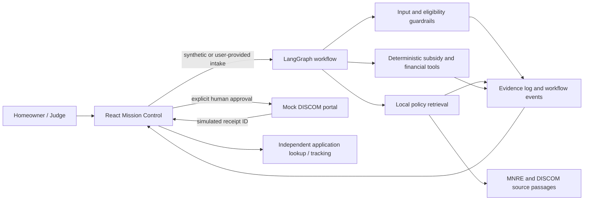

# GoSolar · Rooftop Solar Subsidy Assistant

GoSolar helps a homeowner understand rooftop-solar subsidy steps and prepare an application for a **mock subsidy portal**. It collects inputs, checks scheme and vendor conditions, retrieves policy evidence, pauses for human review, and records a simulated receipt. It does not file with a government service or guarantee subsidy eligibility or payment.

## Hackathon problem fit

The assigned Ziro Agentic AI Hackathon brief is **Rooftop Solar Subsidy Assistant** (Social Impact & Sustainability · AI). The participant dashboard asks for a homeowner workflow that collects consumer number, ownership and planned capacity; applies official scheme and vendor conditions; finds scheme and electricity-board information; fills an application after human approval; returns steps, application ID and pending items; and independently verifies the result.

GoSolar addresses these requirements with a React assessment flow, a LangGraph evaluation and human-approval workflow, source-linked policy evidence, deterministic eligibility guards, and a separate local mock DISCOM portal. A non-production, offline benchmark tray runs the four dashboard test cases. See [HACKATHON_SPEC.md](HACKATHON_SPEC.md) for the captured source requirements and [SUBMISSION.md](SUBMISSION.md) for the judge walkthrough.

## Official dashboard benchmark cases

| Case | Dashboard scenario | Expected verdict | GoSolar behavior |
| --- | --- | --- | --- |
| TC1 | Eligible home | Draft application | Completes checks and pauses at human review. |
| TC2 | Vendor not empanelled | Flagged | Blocks the case with a vendor warning. |
| TC3 | Tenant, not owner | Consent needed | Blocks pending landlord consent / NOC. |
| TC4 | Application ID | Subsidy not promised | Treats a mock receipt as submission evidence only, never as subsidy approval. |

Use **Official benchmark scenarios** in the header to prefill synthetic inputs and evaluate a case. TC1–TC3 call the backend when available and fall back to local deterministic demo rules when it is not. TC4 is a read-only receipt interpretation check. No benchmark case submits a live government application.

## Architecture

This implementation uses a stateful workflow graph with deterministic policy checks and retrieval. It is not represented as multiple autonomous agents: the hackathon rubric has an Agentic Capability category, but does not require a multi-agent architecture.

## Evaluation evidence mapped to the published rubric

The dashboard allocates points to categories, not to individual features. The table maps the implementation evidence to those categories; it is not a score guarantee.

| Rubric category | Points | Evidence in GoSolar |
| --- | ---: | --- |
| Problem fit & usefulness | 20 | Homeowner intake, scheme/vendor checks, application steps, pending items and mock filing flow. |
| Agentic capability | 25 | LangGraph stages, deterministic rules, retrieval, approval interrupt, event trail and separate portal action. |
| Technical implementation | 20 | Typed React UI, FastAPI/Pydantic validation, source records, retries and local mock portal. |
| Innovation | 15 | Offline-first policy retrieval, synthetic benchmark tray and traceable rule evidence. |
| User experience | 10 | Guided steps, explicit blocked/pending states, application tracking and decision inspector. |
| Presentation | 10 | This README, [SUBMISSION.md](SUBMISSION.md), demo script, architecture and benchmark evidence. |

## Run locally

Requirements: Node.js/npm, Python 3.12+, uv. No API key is required for the deterministic workflow or policy retrieval. Optional third-party assessment is disabled unless `GEMINI_API_KEY` is configured.

### Backend and mock portal

From `backend/`, install dependencies once:

~~~powershell
uv sync --group dev
~~~

In one terminal, run the API with `PORT` set to the desired backend port and `CORS_ORIGINS` set only when serving the frontend from another origin. In a second terminal, run the standalone mock portal with `PORT` set to its port and `MOCK_PORTAL_FAIL_STATUS` optionally set to `503` to demonstrate retry handling.

~~~powershell
$env:PORT = '<backend-port>'
$env:CORS_ORIGINS = '<frontend-origin>'
$env:MOCK_PORTAL_URL = 'http://127.0.0.1:<mock-portal-port>'
uv run uvicorn app.main:app --reload --port $env:PORT
~~~

~~~powershell
$env:PORT = '<mock-portal-port>'
uv run uvicorn app.portal.mock_portal:app --reload --port $env:PORT
~~~

Set `VITE_BACKEND_URL` in the frontend environment to the API origin for local Vite proxying. Set the Vite frontend port when launching the dev server. When using same-origin routes in a deployed environment, leave `VITE_API_BASE_URL` blank.

### Frontend

From `frontend/`:

~~~powershell
npm ci
$env:VITE_BACKEND_URL = 'http://127.0.0.1:<backend-port>'
$env:FRONTEND_PORT = '<frontend-port>'
npm run dev -- --port $env:FRONTEND_PORT
~~~

The electricity-bill upload is optional and uses sample extraction when no OCR service is configured. Use synthetic information for the demo.

### Docker Compose

The Compose file reads configurable host/container port variables. Copy `.env.example` to `.env` and adjust those values if the defaults conflict with local services.

~~~powershell
docker compose up --build
~~~

## Verification

From `frontend/`:

~~~powershell
npm run build:check
npm run lint
~~~

From the repository root, after installing backend development dependencies:

~~~powershell
uv run --project backend --group dev python scripts/run_benchmarks.py
uv run --project backend --group dev pytest -v backend/tests
~~~

The benchmark exits nonzero if any official case misses its expected verdict. It uses the in-process mock portal for TC4 and ignores any configured external `MOCK_PORTAL_URL` during that local receipt check.

## Safety, accuracy, and deployment limits

- Portal actions remain behind an explicit human review step. An application ID is a mock receipt, not a subsidy approval or payment confirmation.
- A declared roof planning limit uses 100 sq. ft. per kW; a proposal above declared sanctioned load raises a load-enhancement warning. Missing transformer/feeder data stays pending DISCOM technical sanction; GoSolar does not invent a feeder-capacity check.
- Vendor status and document uploads are declarations in the demo and are not independently authenticated against live registries.
- Policy passages are a local curated snapshot with source links. Verify current scheme and DISCOM terms before relying on the information.
- The workflow state and LangGraph checkpointer are process-local. Use a durable database and shared checkpoint store before multi-instance production deployment.
- The mock portal creates synthetic IDs only. Never send real customer data to this demo.
