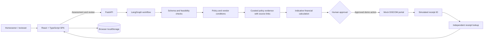

# GoSolar — Rooftop Solar Subsidy Assistant

[](https://github.com/Akshat-2403/Rooftop-Solar-Subsidy-Agent/actions/workflows/ci.yml)
[](https://rooftop-solar-subsidy-agent.vercel.app/)

GoSolar guides a homeowner through a rooftop-solar assessment, explains scheme and vendor checks, prepares a draft for review, and demonstrates a simulated application journey. The app is built for the **Rooftop Solar Subsidy Assistant** challenge in the **Social Impact & Sustainability · AI** track at the Ziro Agentic AI Hackathon 2026.

> **Demo boundary:** GoSolar is not a government service and does not file with MNRE or a live DISCOM. The portal, receipt IDs, local tracking records, and consumer verification indicator are simulated. Estimates are indicative; they are not an eligibility decision, technical sanction, or subsidy approval.

**Try it:** [Open the live demo](https://rooftop-solar-subsidy-agent.vercel.app/) · [Hackathon brief](HACKATHON_SPEC.md) · [Judge walkthrough](SUBMISSION.md)

## Product overview

The guided assessment follows five steps:

1. **Consumer and feasibility** — collect connection, applicant, usage, roof, capacity, and document details. Required values are validated before continuing.
2. **Subsidy selection** — compare available scheme options and indicative assistance.
3. **Vendor and financial planning** — review illustrative installers, costs, savings, and a feasibility summary.
4. **Review and mock portal** — inspect the proposed payload, run the demo audit, and require a human approval step before simulated submission.
5. **Application tracking** — review the receipt and lifecycle milestones.

The header includes a theme switcher, sample data, mock portal, and scenario tray. A source and event inspector exposes policy references, reasons, pending checks, and workflow events so a reviewer can follow how a result was reached.

### Feasibility gates

The intake blocks progression when required information is missing or when the planned system:

- exceeds the declared sanctioned grid load;
- exceeds the planning estimate of **100 sq. ft. of usable roof per kW**.

A low-usage / large-system combination (under 50 kWh monthly use with a request of at least 5 kW) produces a strong warning for review. Consumer connection “verification” in the frontend is a timed demo state; it does not query a real utility account.

### Six scenarios in the app

The first four cases are the scenarios assigned by the hackathon dashboard. The last two are additional **optional GoSolar UI guardrail demonstrations**; they are not extra organizer requirements and are not part of the backend benchmark runner.

| Case | Scenario | Expected behavior | Where it runs |
| --- | --- | --- | --- |
| TC1 · Official | Eligible home | Prepare a draft and pause for human review. | Backend workflow when available; deterministic fallback otherwise |
| TC2 · Official | Vendor not empanelled | Flag the vendor condition and block progression. | Backend workflow when available; deterministic fallback otherwise |
| TC3 · Official | Tenant without landlord NOC | Request consent and keep filing blocked. | Backend workflow when available; deterministic fallback otherwise |
| TC4 · Official | Application ID | Treat a synthetic ID as a receipt, never as subsidy approval/payment. | Read-only receipt check; no filing |
| TC5 · Optional | Capacity above sanctioned load | Block the 5 kW request against a 4 kW sanctioned load. | Frontend feasibility guard |
| TC6 · Optional | Insufficient roof area | Block a 3 kW request with 250 sq. ft. of usable roof. | Frontend feasibility guard |

Select a scenario under **Benchmarks · 6** to see its explainer before the app fills synthetic inputs. TC1–TC3 call the configured evaluation API where available and otherwise show a clearly identified deterministic fallback. TC4 is read-only. TC5 and TC6 exercise the client-side guards. None of these tray actions submits an application.

The executable backend benchmark verifies the four official scenarios only:

```powershell
uv run --project backend --group dev python scripts/run_benchmarks.py
```

## How the agent works

The backend uses a **single LangGraph workflow** with deterministic policy checks, local policy retrieval, and a human approval interrupt. It is not presented as a multi-agent system.



1. **Validate:** Pydantic validates API payloads; workflow rules inspect ownership, grid connection, capacity, vendor, consent, and documents.
2. **Retrieve:** a local, curated source snapshot supplies policy passages with source URLs and retrieval timestamps. The core retrieval path does not require a hosted embedding service.
3. **Explain:** the UI exposes reasons, evidence, events, and unresolved items.
4. **Pause:** LangGraph waits for an explicit human decision before the simulated portal action.
5. **Act and verify:** the mock portal returns a synthetic receipt; a separate lookup checks that receipt. Retry keys prevent duplicate mock receipts.
6. **Track locally:** the browser application store keeps GoSolar tracking records in localStorage for that browser.

Optional Gemini-backed policy reasoning can be enabled with a configured key. The deterministic checks and local retrieval are available without it.

## Technology

| Area | Implementation |
| --- | --- |
| Frontend | React 19, TypeScript, Vite |
| Styling | Tailwind CSS integration plus custom CSS components and themes |
| Backend | FastAPI, Pydantic, Python 3.12 |
| Workflow | LangGraph |
| Policy retrieval | Curated MNRE / DISCOM passages with deterministic local retrieval; optional Gemini reasoning |
| Demo portal | Isolated FastAPI mock DISCOM portal |
| Local persistence | Browser localStorage for drafts, theme preference, and GoSolar application tracking |

## Run locally

### Requirements

- Node.js 22 and npm
- Python 3.12 or 3.13
- uv
- Docker Compose (optional)

No API key is required for the base workflow or local policy retrieval.

### 1. Install backend dependencies

From the repository root:

```powershell
uv sync --project backend --group dev
```

### 2. Start the API

In one terminal from the repository root:

```powershell
$env:PORT = '8000'
uv run --project backend uvicorn app.main:app --reload --port $env:PORT
```

The API health route is available at http://127.0.0.1:8000/health.

### 3. Start the frontend

In another terminal:

```powershell
cd frontend
npm ci
$env:VITE_BACKEND_URL = 'http://127.0.0.1:8000'
npm run dev -- --host 127.0.0.1 --port 5173
```

Open http://127.0.0.1:5173. Vite proxies /api requests to the backend using VITE_BACKEND_URL. In a deployed same-origin setup, VITE_API_BASE_URL can remain blank.

### Optional: run the mock portal separately

The API can use its in-process mock by default. To run the standalone portal in a third terminal, use:

```powershell
$env:PORT = '10000'
uv run --project backend uvicorn app.portal.mock_portal:app --reload --port $env:PORT
```

Then point the backend at it by setting MOCK_PORTAL_URL to http://127.0.0.1:10000 before starting the API. MOCK_PORTAL_FAIL_STATUS=503 can be used to demonstrate retry behavior.

### Optional: Docker Compose

Copy .env.example to .env, adjust ports if needed, then run from the repository root:

```powershell
docker compose up --build
```

## Verification

From frontend/:

```powershell
npm ci
npm run build:check
npm run lint
```

From the repository root after installing backend development dependencies:

```powershell
uv run --project backend --group dev pytest -v backend/tests
uv run --project backend --group dev python scripts/run_benchmarks.py
```

The CI workflow runs frontend type-check/build/lint, backend compile/import checks, and the official four-case benchmark: [GitHub Actions](https://github.com/Akshat-2403/Rooftop-Solar-Subsidy-Agent/actions/workflows/ci.yml).

## Repository map

- frontend/src/App.tsx — assessment, review, tracking, and benchmark orchestration
- frontend/src/components/ — form, selectors, theme, agent inspector, mock portal, and lifecycle UI
- frontend/src/utils/validation.ts — intake validation and feasibility guards
- frontend/src/utils/benchmarks.ts — six UI scenarios and result explanations
- frontend/src/utils/applicationStore.ts — browser-local GoSolar application store
- backend/app/agents/graph.py — LangGraph workflow and human approval interrupt
- backend/app/services/ — eligibility, workflow, financial calculations, and catalogs
- backend/app/rag/retriever.py — curated policy sources and retrieval
- backend/app/portal/mock_portal.py — simulated DISCOM portal
- backend/tests/ — API and workflow tests
- scripts/run_benchmarks.py — official four-case offline benchmark
- SUBMISSION.md — timed demo plan and judge evidence checklist
- HACKATHON_SPEC.md — captured requirements from the participant dashboard

## Accuracy and deployment limits

- Scheme rules and policy passages are a curated snapshot; verify current terms with the relevant authority before relying on them.
- Vendor empanelment and uploaded document status are demo inputs, not authenticated registry or document verification.
- The frontend’s local tracking store is browser-specific. It is not a shared database and will not synchronize across devices.
- Workflow data and the LangGraph checkpointer are in memory for the single-process demo. Use durable storage and a shared checkpointer before horizontal scaling.
- Feeder and transformer capacity are not inferred. Where DISCOM technical data is unavailable, the result remains subject to official sanction.
- Use synthetic data for demonstrations. Do not enter real customer information or treat mock receipts as official records.
